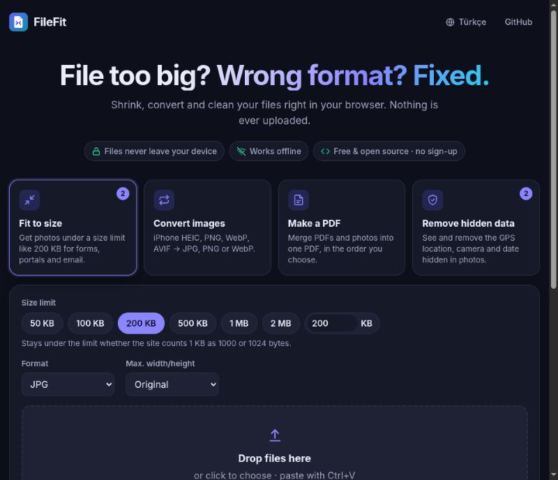
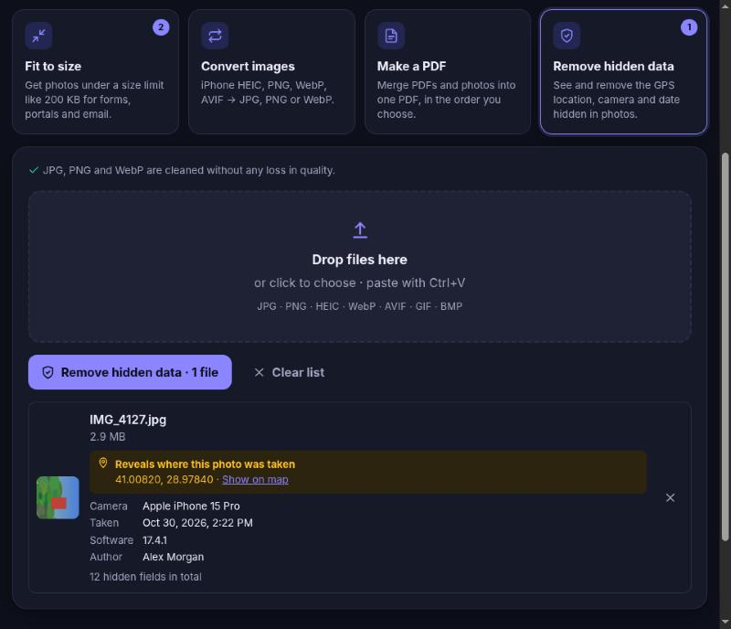

<p align="center">
  
</p>

<h1 align="center">FileFit</h1>

<p align="center">
  <strong>File too big? Wrong format? Fixed, right in your browser.</strong><br />
  Shrink photos under a size limit, convert iPhone HEIC to JPG, merge PDFs and strip GPS location from photos.<br />
  Nothing is uploaded. Works offline. No account, no ads, no tracking.
</p>

<p align="center">
  <a href="https://lxaedith.github.io/filefit/"><strong>Try it live</strong></a> ·
  <a href="README.tr.md">Türkçe</a> ·
  <a href="docs/RESEARCH.md">Why this exists</a> ·
  <a href="#run-it-yourself">Run it yourself</a>
</p>

<p align="center">
  
</p>

---

## The problem

Every day, millions of people hit the same walls:

- A job, visa or government portal says **"maximum file size: 200 KB"** and your phone photo is 3 MB.
- Your iPhone saves **HEIC** files that Windows, many websites and your printer shop won't open.
- You need to send **one PDF**, but you have three scans and two photos.
- You post or email a photo without knowing it carries the **exact GPS location of your home**.

The usual fix is to upload your passport scan, contract or family photo to a random "free online converter". Those sites get hundreds of millions of visits a month, and some of them have [leaked tens of thousands of user documents](https://bgr.com/tech/online-pdf-converters-leaked-thousands-of-user-uploaded-documents/), passports and driver's licences included.

FileFit does the same jobs **on your own device**. Read the [market research](docs/RESEARCH.md) behind it.

## Features

| Tool | What it does |
| --- | --- |
| **Fit to size** | Gets photos under a limit like 50 KB, 200 KB or 1 MB. Searches for the highest quality that fits, and only shrinks the image when quality alone isn't enough. Counts 1 KB as 1000 bytes, so the result passes on sites that count 1024 too. |
| **Convert images** | HEIC/HEIF (iPhone), PNG, WebP, AVIF, GIF, BMP → JPG, PNG or WebP. Optional resize. |
| **Make a PDF** | Merges PDFs **and** photos into one PDF in the order you choose. A4, Letter or image-sized pages, three quality levels to keep the file small. |
| **Remove hidden data** | Shows what a photo reveals (GPS location, camera, date, author) and removes it. JPG, PNG and WebP are cleaned **losslessly**: the image data is copied byte for byte. Orientation is kept, so photos don't end up sideways. |

Plus: batch processing, download all as ZIP, paste from the clipboard (Ctrl+V), drag and drop, English and Turkish, light and dark mode, installable as an app.

<p align="center">
  
</p>

## Private by design, and you can check it

- **No server.** FileFit is a static site. Your files are read by JavaScript in your browser tab and never sent anywhere.
- **Enforced by the browser.** Production builds ship a strict [Content-Security-Policy](vite.config.ts) with `connect-src 'self'`. Even if a dependency tried to upload something, the browser would refuse. Open DevTools and see for yourself.
- **Works offline.** After the first visit everything is cached by a service worker. Turn off Wi-Fi and keep going.
- **No tracking.** No analytics, no cookies, no third-party requests.

## How it works

- **Target-size compression** binary-searches the JPEG/WebP quality between 50 % and 92 %. If even 50 % is too big, the image is scaled down by `√(target / size)` and searched again. Large reductions are drawn in halving steps for a sharper result. See [`src/lib/search.ts`](src/lib/search.ts) and [`src/tools/fit.ts`](src/tools/fit.ts).
- **Lossless metadata removal** parses the file format directly: JPEG segments ([`jpeg.ts`](src/lib/jpeg.ts)), PNG chunks ([`png.ts`](src/lib/png.ts)) and WebP RIFF chunks ([`webp.ts`](src/lib/webp.ts)). EXIF, XMP, IPTC, comments, C2PA blocks and trailing data are dropped. Colour profiles are kept. A 36-byte EXIF block holding only the orientation is written back.
- **HEIC decoding** uses [libheif](https://github.com/strukturag/libheif) compiled to WebAssembly (via [heic-to](https://github.com/hoppergee/heic-to)), loaded only when you open a HEIC file.
- **PDFs** are built with [pdf-lib](https://pdf-lib.js.org/).
- The first load is under 20 KB gzipped. Heavy parts (PDF, HEIC, metadata reader) load only when a tool needs them.

## Run it yourself

You need [Node.js](https://nodejs.org/) 20.19 or newer.

```bash
git clone https://github.com/LXAedith/filefit.git
cd filefit
npm install
npm run dev        # http://localhost:5173
```

```bash
npm test           # unit tests (Vitest)
npm run build      # type-check and production build into dist/
npm run preview    # serve the production build, CSP and offline mode included
```

### Deploy to GitHub Pages (free)

1. Push this repository to GitHub.
2. Go to **Settings → Pages** and set **Source** to **GitHub Actions**.
3. Every push to `main` now runs the tests, builds and publishes the site to `https://LXAedith.github.io/filefit/` ([workflow](.github/workflows/deploy.yml)).

Remember to point `REPO_URL` in [`src/config.ts`](src/config.ts) at your repository.

## Project structure

```
src/
  main.ts          UI: tools, file list, drag & drop, ZIP download
  i18n.ts          English and Turkish texts
  tools/           fit.ts, convert.ts, pdf.ts, clean.ts
  lib/             format sniffing, image decode/encode, JPEG/PNG/WebP metadata strippers, quality search
  sw-template.js   offline service worker (file list is filled in at build time)
tests/             unit tests for the pure logic
```

## Roadmap

- [ ] Compress existing PDFs (re-render scanned pages)
- [ ] Split PDFs and pick pages
- [ ] Crop to passport/ID photo sizes
- [ ] More languages: contributions welcome, see [`src/i18n.ts`](src/i18n.ts)

## Contributing

Issues and pull requests are welcome. Please run `npm test` and `npm run build` before opening a PR. Adding a language is just a matter of copying the `tr` block in [`src/i18n.ts`](src/i18n.ts).

## License

[MIT](LICENSE). Third-party parts: pdf-lib (MIT), exifr (MIT), fflate (MIT), heic-to and libheif (LGPL-3.0, loaded as a separate module).
