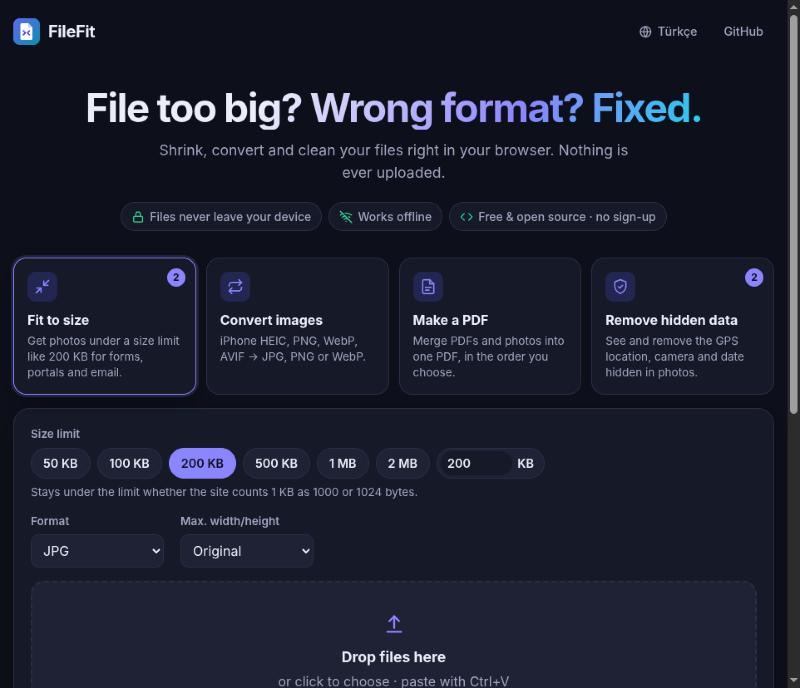
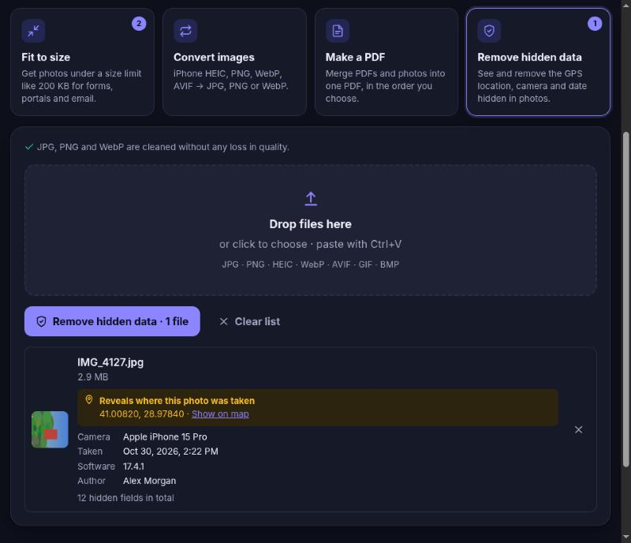

<p align="center">
  
</p>

<h1 align="center">FileFit</h1>

<p align="center">
  <strong>Dosya çok mu büyük? Formatı mı yanlış? Tarayıcında hallet.</strong><br />
  Fotoğrafları boyut sınırının altına indir, iPhone HEIC'i JPG'ye çevir, PDF'leri birleştir, fotoğraflardaki GPS konumunu sil.<br />
  Hiçbir şey internete yüklenmez. İnternetsiz çalışır. Üyelik, reklam ve takip yok.
</p>

<p align="center">
  <a href="https://lxaedith.github.io/filefit/"><strong>Hemen dene</strong></a> ·
  <a href="README.md">English</a> ·
  <a href="docs/ARASTIRMA.md">Neden bu proje?</a> ·
  <a href="#kendin-çalıştır">Kendin çalıştır</a>
</p>

<p align="center">
  
</p>

---

## Sorun

Her gün milyonlarca kişi aynı duvara çarpıyor:

- e-Devlet, iş başvurusu, vize ya da üniversite sitesi **"en fazla 200 KB"** diyor, telefon fotoğrafın 3 MB.
- iPhone **HEIC** kaydediyor; Windows, birçok site ve fotoğrafçı bu dosyayı açamıyor.
- **Tek bir PDF** göndermen gerekiyor ama elinde üç tarama ve iki fotoğraf var.
- Bir fotoğrafı paylaşıyorsun ama içinde **evinin tam GPS konumu** olduğunu bilmiyorsun.

Çoğu kişinin çözümü kimlik taramasını, sözleşmesini ya da aile fotoğrafını rastgele bir "ücretsiz online dönüştürücüye" yüklemek. Bu siteler ayda yüz milyonlarca ziyaret alıyor ve bazıları pasaport ve ehliyetler dahil [on binlerce kullanıcı belgesini sızdırdı](https://bgr.com/tech/online-pdf-converters-leaked-thousands-of-user-uploaded-documents/).

FileFit aynı işleri **kendi cihazında** yapar. Projenin arkasındaki [pazar araştırmasını](docs/ARASTIRMA.md) okuyabilirsin.

## Özellikler

| Araç | Ne yapar |
| --- | --- |
| **Boyuta sığdır** | Fotoğrafları 50 KB, 200 KB, 1 MB gibi bir sınırın altına indirir. Sığan en yüksek kaliteyi arar; resmi sadece kalite yetmediğinde küçültür. 1 KB'ı 1000 bayt sayar, böylece 1024 sayan sitelerden de geçer. |
| **Resim dönüştür** | HEIC/HEIF (iPhone), PNG, WebP, AVIF, GIF, BMP → JPG, PNG veya WebP. İsteğe bağlı yeniden boyutlandırma. |
| **PDF oluştur** | PDF'leri **ve** fotoğrafları istediğin sırayla tek PDF'te birleştirir. A4, Letter ya da resim boyutunda sayfa; dosyayı küçük tutmak için üç kalite seviyesi. |
| **Gizli bilgileri sil** | Fotoğrafın neleri ele verdiğini (GPS konumu, kamera, tarih, sahibi) gösterir ve siler. JPG, PNG ve WebP **kayıpsız** temizlenir: görüntü verisi bayt bayt aynen kopyalanır. Yön bilgisi korunur, fotoğraflar yan dönmez. |

Ayrıca: toplu işlem, ZIP olarak indirme, panodan yapıştırma (Ctrl+V), sürükle-bırak, Türkçe ve İngilizce, açık ve koyu tema, uygulama olarak yüklenebilme.

<p align="center">
  
</p>

## Gizlilik tasarımın parçası, üstelik doğrulanabilir

- **Sunucu yok.** FileFit statik bir site. Dosyaların tarayıcı sekmesindeki JavaScript tarafından okunur ve hiçbir yere gönderilmez.
- **Tarayıcı tarafından zorunlu kılınır.** Production build'de `connect-src 'self'` içeren sıkı bir [Content-Security-Policy](vite.config.ts) var. Bir kütüphane bir şey yüklemeye kalksa bile tarayıcı engeller. Geliştirici araçlarını açıp kendin bak.
- **İnternetsiz çalışır.** İlk ziyaretten sonra her şey service worker ile önbelleğe alınır. Wi-Fi'ı kapat, kullanmaya devam et.
- **Takip yok.** Analitik, çerez ya da üçüncü taraf isteği yok.

## Kendin çalıştır

[Node.js](https://nodejs.org/) 20.19 veya üstü gerekir.

```bash
git clone https://github.com/LXAedith/filefit.git
cd filefit
npm install
npm run dev        # http://localhost:5173
```

```bash
npm test           # birim testleri (Vitest)
npm run build      # tip kontrolü ve dist/ içine production build
npm run preview    # production build'i CSP ve çevrimdışı mod dahil sun
```

### GitHub Pages'e ücretsiz yayınla

1. Depoyu GitHub'a gönder.
2. **Settings → Pages** altında **Source** olarak **GitHub Actions** seç.
3. Artık `main` dalına her push'ta testler çalışır, site derlenir ve `https://LXAedith.github.io/filefit/` adresinde yayınlanır ([iş akışı](.github/workflows/deploy.yml)).

[`src/config.ts`](src/config.ts) içindeki `REPO_URL` değerini kendi deponla değiştirmeyi unutma.

## Katkı

Issue ve pull request'ler memnuniyetle karşılanır. PR açmadan önce `npm test` ve `npm run build` çalıştır. Yeni dil eklemek için [`src/i18n.ts`](src/i18n.ts) içindeki `tr` bloğunu kopyalaman yeterli.

## Lisans

[MIT](LICENSE). Üçüncü taraf parçalar: pdf-lib (MIT), exifr (MIT), fflate (MIT), heic-to ve libheif (LGPL-3.0, ayrı modül olarak yüklenir).
